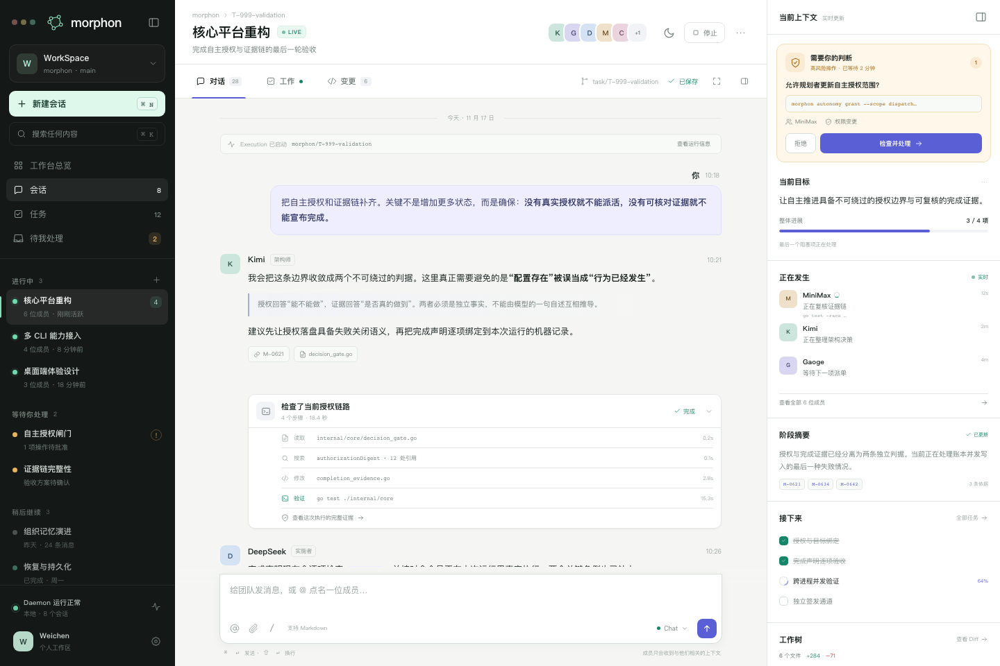

# Morphon

**A living organization of autonomous agents.**

Morphon brings conversation, coordinated work, evidence, and code review into one calm workspace. Give a team a goal, watch responsibilities take shape, and step in when a human decision is actually needed.

## Meet your organization

- **Discuss in context** — keep human direction, agent replies, and decisions together.
- **Move work forward** — follow goals, tasks, member activity, and outcomes without digging through logs.
- **Review with confidence** — connect code changes and approvals to the conversation that produced them.
- **Stay in control** — use Steer while work is running, and make important approvals explicit.

## Download

Prebuilt applications are available from [GitHub Releases](https://github.com/NaiTangBaoBao/morphon/releases).

Current release: **0.1.0 Alpha 1 — Early Preview**.

See the [installation guide](docs/install.md). Release binaries are attached to their release; this repository does not commit binary files.

## Product tour

Explore the [visual demo](demo/README.md), including the conversation workspace, execution view, change review, and dark theme.

## Repository purpose

This public repository contains only product information, visual demos, and release downloads. Source code and internal technical documentation are not published here.
