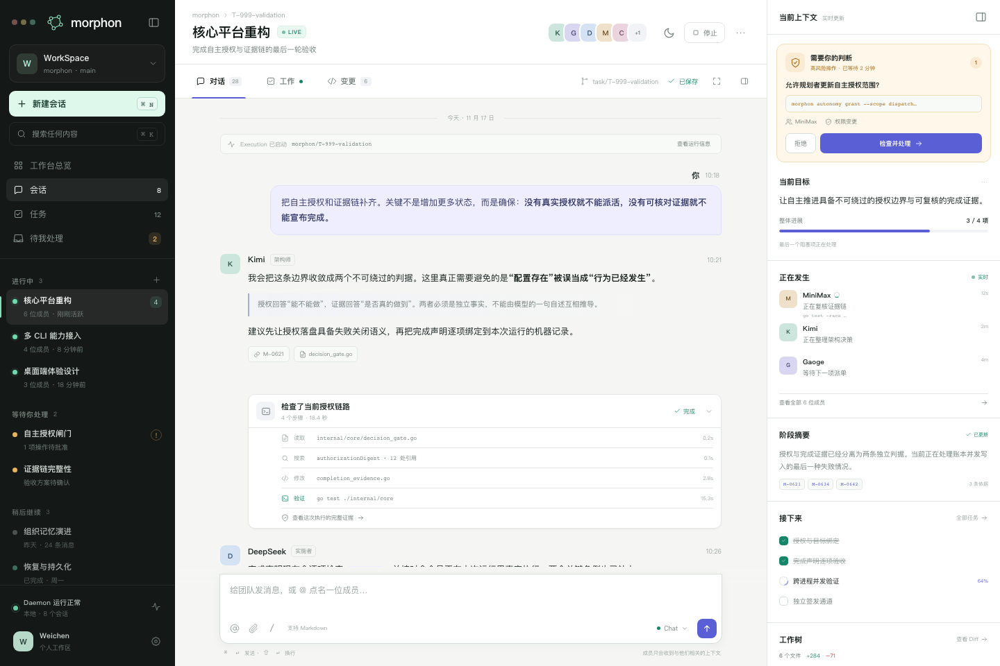
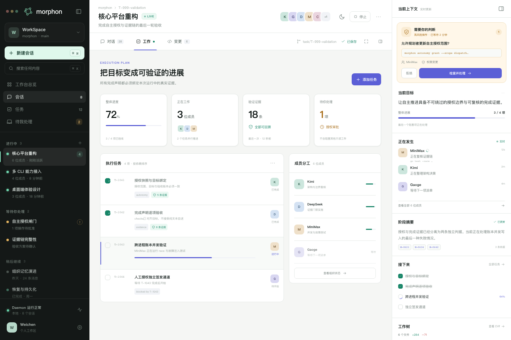
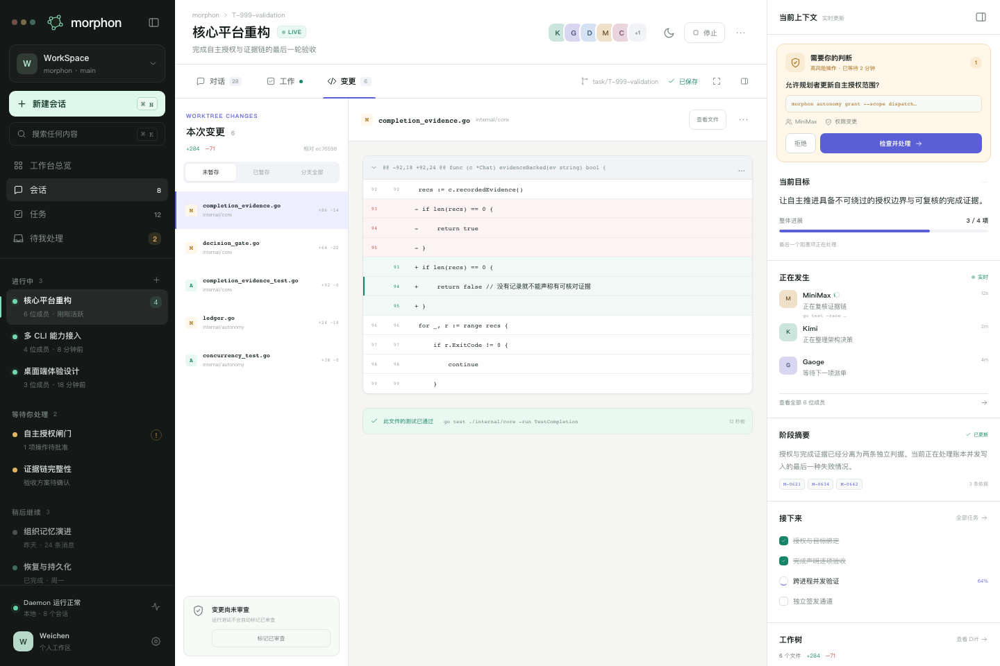
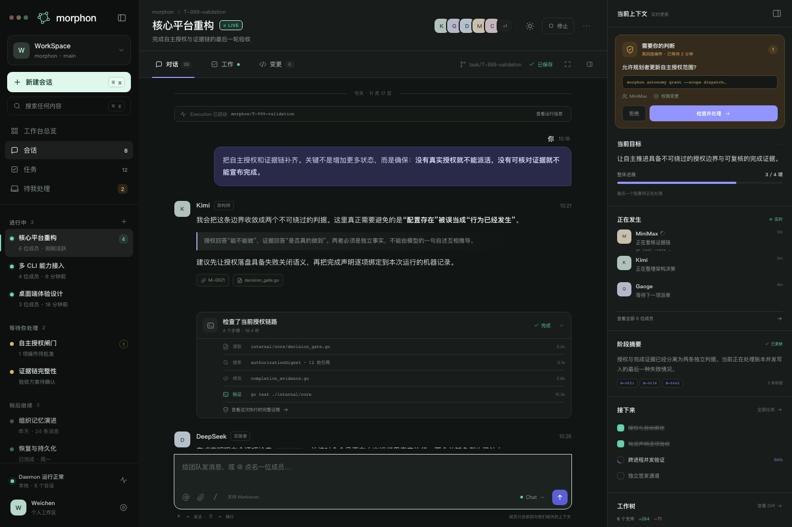

# Morphon visual demo

A short tour of the Early Preview workspace.

## Conversation and human control

A focused discussion stream keeps human instructions and agent responses readable. The surrounding workspace shows live member activity, current goals, summaries, and pending approvals.

## Coordinated execution

The work view turns a goal into visible tasks and real member activity. Progress is drawn from the running session rather than decorative sample charts.

## Change review

Code changes and review state stay connected to the same session, reducing the gap between deciding what to do and inspecting what changed.

## Dark theme

The complete workspace supports a low-light reading mode.

